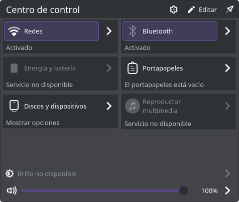

# Plasma Control Hub

Bandeja del sistema, centro de control editable y notificaciones laterales para **KDE Plasma 6.8**. Derivado del código original de KDE Plasma Workspace **6.8.1**; conserva el aspecto del tema de Plasma y utiliza Kirigami, Plasma Components y Plasma Extras.




[Editor de controles](docs/screenshots/editor.png) · [Bandeja de aplicaciones](docs/screenshots/tray.png) · [Notificaciones laterales](docs/screenshots/notifications.png)

Las capturas proceden de una sesión aislada: algunos servicios, incluido PowerDevil, no están ejecutándose y aparecen como no disponibles.

## Funcionamiento

- Un botón abre el centro de control con los plasmoides disponibles en el sistema.
- Wi-Fi y Bluetooth utilizan las acciones originales de KDE para activar/desactivar; la flecha de cada control abre su vista completa.
- Brillo y volumen quedan fijos al pie del panel, fuera de la cuadrícula desplazable, con botones para abrir todas sus opciones originales. Sus deslizadores utilizan los módulos de KDE instalados.
- «Editar» permite mostrar, quitar y ordenar controles. El orden y la selección se guardan por instancia del widget.
- Las aplicaciones permanecen en la bandeja o en el desplegable de la flecha. Se pueden mover por arrastre y configurar desde el menú contextual. Mayús+F10 alterna la visibilidad del icono enfocado.
- En la configuración original del widget, **Entradas → Mostrar siempre** coloca también cualquier módulo de KDE en la barra: método de entrada, teclado, Bluetooth, etc. Conserva su representación compacta original y sus interacciones. «Editar» sigue dedicado a la distribución del centro de control.
- Las notificaciones sin leer se indican con un punto pequeño en la esquina superior derecha del icono; la cantidad permanece en su descripción al pasar el cursor.
- El botón de notificaciones abre el historial original en el borde derecho. La ventana usa el estilo de Plasma y solicita a KWin la animación desde la derecha.
- Flecha, centro y notificaciones comparten tamaño de celda y símbolos SVG propios, coloreados por Plasma. Las opciones sin icono disponible reciben un símbolo de reserva propio.
- Las funciones detalladas y la configuración de cada módulo siguen perteneciendo a los plasmoides originales.

Es un proyecto independiente y experimental, no un componente oficial de KDE. Consulta [la procedencia del código](UPSTREAM.md), [la arquitectura](docs/architecture.md) y [las comprobaciones](docs/validation.md).

## Compilar

Requiere las cabeceras de desarrollo de Qt 6.10 o posterior, KDE Frameworks 6.31 o posterior y Plasma 6.8. La versión de referencia es Plasma 6.8.1 con Qt 6.12. Se utilizan algunas interfaces privadas de Plasma: las actualizaciones mayores requieren comprobar compatibilidad.

En Arch Linux / CachyOS, las dependencias se suministran con estos paquetes:

```sh
sudo pacman -S --needed base-devel cmake ninja extra-cmake-modules qt6-base qt6-declarative plasma-workspace plasma-nm bluedevil plasma-pa powerdevil qt6-wayland wayland gettext
cmake -S . -B build -G Ninja -DCMAKE_BUILD_TYPE=Release -DCMAKE_INSTALL_PREFIX="$HOME/.local"
cmake --build build --parallel 2
```

Para ciclos rápidos de desarrollo se puede configurar `-DQT_QML_NO_CACHEGEN=ON`. La versión normal conserva la compilación anticipada de QML.

## Probar sin modificar el escritorio

```sh
QT_QPA_PLATFORM=offscreen QT_QUICK_BACKEND=software ctest --test-dir build --output-on-failure
```

Para la prueba de integración se requieren también `xorg-server-xvfb`, `xorg-xauth`, `python`, `libxtst` y `dbus`. Esta prueba utiliza una pantalla virtual y un bus D-Bus aislado. No cambia el estado de Wi-Fi, Bluetooth, volumen ni brillo.

Para abrir una ventana de revisión independiente con los módulos reales:

```sh
./scripts/preview.sh
```

## Instalar para el usuario

```sh
./scripts/install-local.sh
```

El instalador añade nuestro plugin y un archivo de entorno que permite descubrirlo en la siguiente sesión de Plasma. Después de cerrar y volver a iniciar sesión, añade **Centro de control de Plasma** desde «Añadir elementos gráficos». Instálalo en un panel para utilizarlo como bandeja.

La instalación conserva la bandeja original y la distribución de tu escritorio. Para usarlo como sustituto, retira la bandeja anterior desde el modo de edición del panel; así evitas mantener dos vistas de los mismos controles. KDE sigue siendo el proveedor del servicio de notificaciones.

## Licencias y mantenimiento

Los archivos importados conservan sus avisos y licencias SPDX. Los cambios nuevos indican su licencia en cada archivo. Los textos completos están en `LICENSES/`. El commit inicial contiene la importación original para facilitar la revisión y futuras actualizaciones de KDE.
